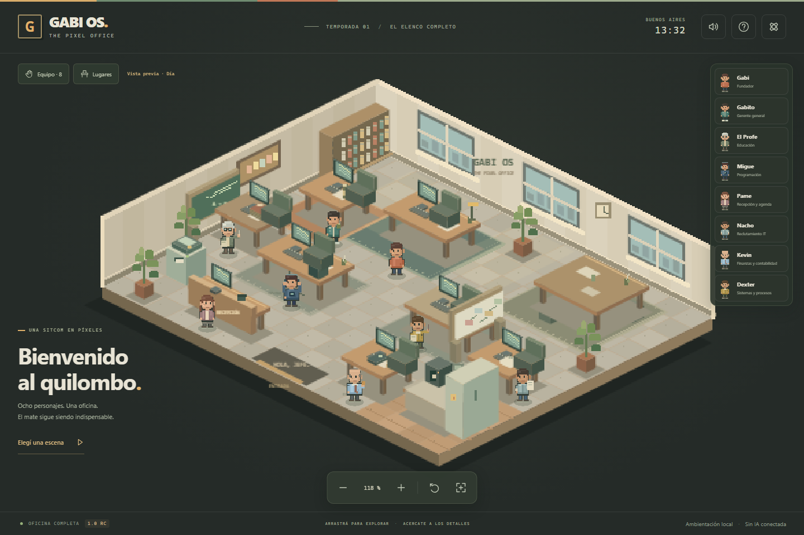

# GABI OS — The Pixel Office

Una pequeña oficina, un gran quilombo. Versión **1.0.0-rc.1** con los ocho personajes, siete lugares interactivos, escenas de sitcom, ciclo de Buenos Aires y audio original opcional. Construida con TypeScript, Vite y Phaser. Todo lo que sucede es ambientación local: no hay IA, OpenClaw, WhatsApp ni servicios pagos conectados.



## Ejecutar

Requisito: Node.js 22.12 o posterior (probado con Node 24).

```powershell
cd "C:\Users\gabri\OneDrive\DESCARGAS\Proyecto The Office\gabi-os"
npm ci
npm run dev
```

Abrir **http://localhost:5173/gabi-os/**. Vite también muestra la dirección de la red local para probar desde el teléfono conectado al mismo Wi-Fi. El firewall de Windows debe permitir ese acceso. No hay servidor de agentes que configurar.

Para revisar el resultado compilado:

```powershell
npm run build
npm run preview
```

Abrir **http://localhost:4173/gabi-os/**. `dist/` es el sitio estático listo para un despliegue posterior autorizado.

## Probar la oficina completa

1. Ver la oficina completa; acercarse con rueda, pinza o botones. Arrastrar con mouse/un dedo. Restablecer vista con el botón de flecha circular o Inicio.
2. Tocar un personaje, elegirlo en la **columna del borde derecho** o abrir **Equipo · 8**: Gabi, Gabito, El Profe, Migue, Pame, Nacho, Kevin y Dexter. La columna se desplaza verticalmente si falta altura; en móvil usa retratos y nombres compactos. Cada uno tiene una acción propia, además de saludar, mate, paseo y escritorio. En móvil la ficha se cierra al ejecutar para dejar ver la animación.
3. Activar seguimiento desde una ficha. Arrastrar para dejar de seguir. Las escenas nunca cambian el encuadre por su cuenta.
4. Abrir **Lugares** o tocar los objetos: escritorio de Gabi, sala, cafetería, pizarrón, fotocopiadora, recepción y termo. La bandeja/tablero, materias y agenda son demostraciones rotuladas. El cuadro de Boca es un motivo propio reservado, sin escudo oficial.
5. Elegir una escena desde Lugares → Ver escenas. Ver a Migue y Dexter debatir, Gabito y Kevin discutir el café, o convocar una reunión de ocho. Pausar, avanzar, terminar u omitir. Los participantes se acercan por rutas; la cámara no se mueve por la escena. Cada especialista también tiene un confesionario propio.
6. Cambiar colores, peinado, vestimenta, barba, anteojos, gorra o auriculares de Gabi. Recargar y comprobar persistencia. Gabi nunca emite diálogos automáticos en nombre del usuario.
7. Activar reducción de movimiento y probar los perfiles gráficos. Alto/equilibrado: límite de 60 FPS; liviano: 30 FPS y sombras de personajes desactivadas. Automático elige liviano en pantallas de menos de 600 px. Son límites, no garantías de rendimiento.

8. En Configuración → Ciclo visual, comparar mañana, día, tarde/noche y madrugada. Las vistas previas quedan identificadas. En horario real se usa `America/Argentina/Buenos_Aires`; de madrugada la oficina se vacía. Un personaje solicitado expresamente puede aparecer como escena a pedido, sin fingir horas extra.
9. Activar audio desde el botón de la cabecera. Probar música y efectos con volúmenes separados, incluido cero para silenciar cada canal. **Cada carga inicia silenciada**, aunque las preferencias de volumen se conserven. La música es una composición procedural original y los efectos son síntesis local, sin archivos externos.
10. Probar bienvenida opcional: una vez por sesión, omisible, apagable junto al humor. No se inicia si el usuario ya seleccionó un personaje.

La ambientación y el audio se pausan al ocultar la página. No hay trabajo persistente cuando el navegador está cerrado.

## Verificaciones

```powershell
npm test
npm run build
npx playwright install chromium
npm run test:e2e
```

En Windows, para usar Edge instalado en lugar de descargar Chromium:

```powershell
$env:PW_CHANNEL = "msedge"
npm run test:e2e
```

Para comprobar la compilación de producción con las mismas pruebas:

```powershell
$env:OFFICE_PREVIEW = "1"
npm run test:e2e
```

Pruebas unitarias: conectividad, obstáculos, circulación de ocho personas hacia la reunión sin colisiones, reservas de destinos, cancelación sin teletransporte, horario de Buenos Aires, contenido y preferencias compatibles con el piloto. Pruebas de navegador: las ocho fichas, siete confesionarios, siete hotspots, escenas y omisión, controles de cámara, pinza nativa, día/noche, bienvenida, audio con gesto explícito y volúmenes separados, fallos de audio y persistencia. La emulación de iPhone 13 **en Chromium** no reemplaza la prueba física en Safari/iPhone.

## Organización

- `src/art/`: arte original, paleta y spritesheets de 288 cuadros por personaje, mobiliario de oficio y pantallas emisivas nocturnas.
- `src/office/`: mapa, grilla, A*, circulación coordinada, personajes, escenas, horario, cámara y gestos.
- `src/content/`: perfiles, apariencias, textos, relaciones y libretos.
- `src/audio/`: composición y efectos originales mediante Web Audio; inicio silenciado.
- `src/ui/`: paneles HTML accesibles, controles, confesionario y configuración.
- `src/core/`: preferencias versionadas, eventos ambientales y contratos separados para tareas reales futuras.
- `public/`: favicon y puente para retirar el service worker del dashboard viejo en un futuro despliegue.
- `docs/`: Documento Maestro, prompt de referencia, estado del alcance y decisiones técnicas.

## Rama y recuperación

- Desarrollo: **`dev/pixel-office`**.
- Versión anterior guardada en GitHub ANTES de reconstruir: **`archive/pre-pixel-office-2026-10-27`**.
- Commit anterior: **`43c380ef681730d646b596ead32d528673032bb4`**.

Para inspeccionar la versión anterior sin tocar la rama de trabajo:

```powershell
git fetch origin
git show origin/archive/pre-pixel-office-2026-10-27:index.html
```

La restauración de producción se hará únicamente con autorización. No hay migración de tareas, notas o datos del dashboard; el nuevo código no lee ni borra la clave antigua `gabi-os-v1`.

## Publicación en GitHub Pages

Vite usa `base: '/gabi-os/'`. El workflow de desarrollo solo prueba y genera un artefacto descargable; **no publica**. Se eliminó de esta rama el extractor ZIP que sobrescribía fuentes.

El piloto 0.1 fue publicado con autorización y Pages ya está configurado para GitHub Actions. Esta ampliación RC se prepara en **dev/pixel-office** y no reemplaza automáticamente la web pública. El workflow `pages.yml` es manual, exige `main` y la entrada `PUBLICAR`. Después de revisar y aprobar esta versión, se podrá integrar y desplegar. La entrada manual reduce errores accidentales; no sustituye los permisos de GitHub ni la aprobación humana.

No se registra un service worker nuevo. `public/service-worker.js` retira únicamente las cachés `gabi-os-shell-*` del dashboard anterior. No toca localStorage ni cachés de otras aplicaciones. El modo offline/PWA nuevo queda para una etapa posterior y no es necesario para usar la oficina online.

## Próximas etapas

Ver [estado de la versión completa y aceptación pendiente](docs/ESTADO_VERSION_1.0.md). La RC contiene la ampliación funcional; su cierre como 1.0 definitiva requiere revisión visual del usuario y comprobación en dispositivos reales.
